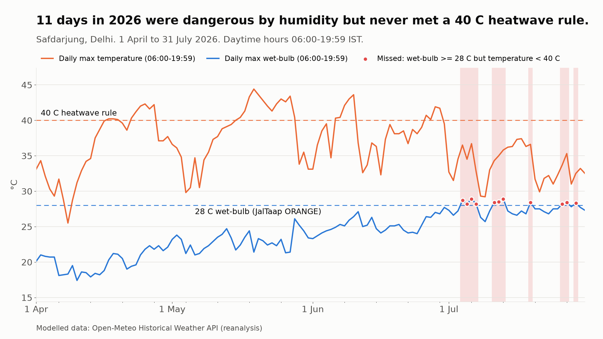
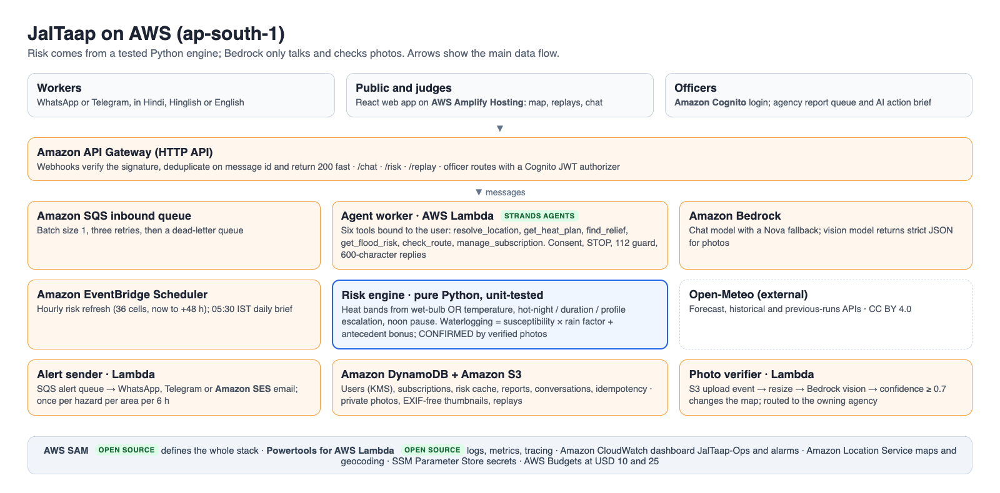

# JalTaap · जलताप

**A WhatsApp-first heat and waterlogging safety copilot for Delhi's outdoor workers.**
In summer it turns the forecast for a worker's exact spot into a humidity-aware safe-work plan
in Hindi. In the monsoon it warns about street-level waterlogging, and it routes AI-verified photo
reports to the agency that owns each spot.

Built on AWS by **Team DevCore** for Environmental Hacks (WeMakeDevs × AWS Bharat Builds Tour),
Heat & Water track, 8–11 October 2026.

| | |
|---|---|
| Live site | _add the Amplify URL_ |
| Demo video | _add the YouTube link_ |
| Writeup | [docs/writeup.md](docs/writeup.md) |

Weather data by [Open-Meteo.com](https://open-meteo.com/) (CC BY 4.0). Map data © OpenStreetMap contributors.

---

## The problem

Delhi already has hotspot lists, pumps, cooling zones, tankers and helplines. Its warnings,
though, are city-wide and temperature-only, and they rarely reach the people working outdoors.

- Several parts of Delhi crossed **46 °C on 22 May 2026** ([UNI](https://www.uniindia.com/)).
- Delhi Traffic Police flagged **169 waterlogging-prone hotspots** in 2026, and official
  lists change every year ([Daily Pioneer](https://dailypioneer.com/)).
- The ILO projects India loses **5.8 % of working hours to heat by 2030**
  ([The Quint](https://www.thequint.com/)).

**The insight:** a 40 °C rule misses humid heat. A 36 °C afternoon at 65 % humidity gives a
wet-bulb near 30 °C, which is at the limit of what a healthy body can cool against. JalTaap
scores wet-bulb temperature, hot nights and heat duration per hour, per place and per person.

**Our own number (Backtest A, modelled data):**
_11 days in 2026 were dangerous by humidity but never met a 40 °C heatwave rule_.
This is for Safdarjung, 1 April to 31 July 2026, daytime 06:00–19:59 IST, using Open-Meteo
reanalysis. See [backtests/README.md](backtests/README.md).



## What works today

| Feature | Where | Status |
|---|---|---|
| Hourly heat plan for a place name or location pin, in Hindi, Hinglish or English | WhatsApp, Telegram, web chat | P0 |
| Nearest cooling zone, water point or hospital, with a directions link | all channels | P0 |
| Heatstroke symptoms → "Call 112 now" on line 1, then first aid | all channels | P0 |
| Consent on first contact; STOP deletes the user, subscriptions and history | WhatsApp, Telegram | P0 |
| Public map: 36-cell heat layer, now to +48 h, 22 May 2026 replay | web | P0 |
| Waterlogging risk for listed hotspots, with owning agency; route check | all channels | P1 |
| Subscriptions, proactive alerts (6-hour dedupe), 05:30 IST daily brief | WhatsApp, Telegram | P1 |
| Photo report → Bedrock vision verdict → map pin → officer queue | all channels | P1 |
| Officer view with Cognito login and an AI action brief | web `/officer` | P1 |
| 9 July 2026 storm replay and a humid-heat replay (13 July 2026) | web | P1 |

## How it works



- **Webhooks never time out.** They only verify the signature (WhatsApp HMAC, Telegram secret
  header), deduplicate on the message id and put the message on SQS.
- **One worker per message.** The worker runs a Strands agent with six tools.
- **The agent never computes risk.** Its tools call the same unit-tested Python risk engine that
  the hourly scheduler runs.
- **Every number has a source.** The agent answers only from tool results, and every forecast
  reply ends with `Data: Open-Meteo, HH:MM IST`.
- **Photos are checked before they count.** A photo lands in S3, a Bedrock vision model returns
  strict JSON, and only a verdict with confidence ≥ 0.7 changes the map.

### Risk engine (`backend/risk/`, driven by `risk.yaml`)

**Heat.** An hour is:

| Band | Wet-bulb | or | Temperature |
|---|---|---|---|
| RED | ≥ 30 °C | or | ≥ 44 °C |
| ORANGE | ≥ 28 °C | or | ≥ 40 °C |
| YELLOW | ≥ 25 °C | or | ≥ 37 °C |
| GREEN | otherwise | | |

- **Escalation.** Bands go up by at most +1 for the environment (a hot night ≥ 30 °C, or the
  third ORANGE day in a row) and at most +1 for the person (heavy work, age 60+, pregnancy,
  chronic illness, not acclimatised). The result is capped at RED.
- **Noon pause.** On ORANGE days and worse, outdoor work pauses from 12:00 to 15:00, following
  the Delhi Heat Action Plan 2026.

**Waterlogging.**

- `risk = min(1, susceptibility × rain_factor + antecedent_bonus)`.
- A verified photo within 300 m in the last 2 hours sets the level to **CONFIRMED**.

### Where AWS fits

| Piece | Job |
|---|---|
| **Strands Agents SDK** (AWS open source) | The agent: tool calling, language mirroring, one-line model swap |
| **AWS SAM CLI** (AWS open source) | The whole backend as code in `template.yaml`; one-command deploy |
| **Powertools for AWS Lambda** (AWS open source) | Structured logs, custom metrics (namespace `JalTaap`), tracing |
| Amazon Bedrock | Chat model with a Nova fallback; vision model for photo checks; officer briefs |
| AWS Lambda | 10 functions: webhooks, agent worker, chat API, risk refresh, daily brief, alert sender, verifier, public and officer APIs |
| Amazon API Gateway (HTTP API) | Webhooks, chat, map data, officer routes with a Cognito JWT authorizer |
| Amazon SQS | Inbound and alert queues, each with a dead-letter queue |
| Amazon EventBridge Scheduler | Hourly risk refresh; 05:30 IST daily brief |
| Amazon DynamoDB | Users, subscriptions, risk cache, reports, conversations, idempotency |
| Amazon S3 | Private photos (30-day lifecycle), EXIF-free thumbnails, seed data, replays |
| AWS Amplify Hosting | The public web app |
| Amazon Cognito | Officer login and the `officers` group |
| Amazon CloudWatch | `JalTaap-Ops` dashboard, alarms, 7-day log retention |
| Amazon Location Service | Base map (Maps v2) and geocoding (Places v2) |
| Amazon SES | Officer alert emails |
| AWS Systems Manager Parameter Store | Every secret, read at runtime |
| AWS Budgets | Cost alerts at USD 10 and USD 25 |

## Repository layout

```
template.yaml        AWS SAM: the whole backend
layer/               DepsLayer (Linux wheels, built with a Makefile; no Docker needed)
backend/
  risk/              wetbulb.py, heat.py, flood.py, grid.py, openmeteo.py, imd.py, service.py, config/risk.yaml
  agent/             agent.py, tools.py, prompts.py, location.py, session.py
  common/            config, secrets (SSM), dynamo, i18n, geo, photo, vision, channels/ (whatsapp, telegram, ses)
  handlers/          webhook_whatsapp, webhook_telegram, worker, chat_api, risk_refresh, daily_brief,
                     alert_sender, verifier, public_api, officer_api
  refdata/           bundled fallback copy of data/*.json
  tests/             127 pytest tests (moto for AWS)
web/                 React + Vite + TypeScript + MapLibre + Tailwind + i18next (see web/README.md)
data/                seed CSVs, geocoding script, grid, GEOCODING_REVIEW.md
backtests/           Backtests A, B, C and the replay builder, with outputs/
evals/               26 agent eval cases and the runner
scripts/             put_secrets, check_bedrock, seed_s3, set_webhooks, smoke, dev_api
docs/                api-contract.md, writeup.md, blog.md, architecture.png
```

## Run it locally

```bash
python3 -m venv .venv && .venv/bin/pip install -r backend/requirements-dev.txt
.venv/bin/pytest                                   # 127 tests: risk engine, webhooks, worker, verifier, APIs
.venv/bin/python scripts/dev_api.py --port 8787    # real handlers on moto + live Open-Meteo
cd web && npm install && VITE_API_URL=http://127.0.0.1:8787 npm run dev
```

The dev API emulates DynamoDB, S3 and SQS. Bedrock is not emulated: without AWS credentials,
`/chat` returns the fixed "data unavailable" reply, which is what production does when the
model is down.

## Deploy (team runbook)

Everything runs in **ap-south-1 (Mumbai)**. Install the AWS CLI v2 and the AWS SAM CLI. Docker
is not needed.

1. **Account guardrails (M0).** Enable root MFA and give each member their own login.
   - Budgets are created by the stack at USD 10 and 25 when you pass `AlarmEmail`.
   - If you deploy without `AlarmEmail`, create them in the console first.
2. **Bedrock access.** Run `./scripts/check_bedrock.sh <ModelId> <FallbackModelId>`.
   - If an Anthropic model is denied, submit the one-time use-case form in the Bedrock console.
   - Choose ids that show up in the list. The defaults are
     `global.anthropic.claude-haiku-4-5-20251001-v1:0` and `apac.amazon.nova-lite-v1:0`.
3. **Strands layer.** Find the current layer version in the
   [Strands Lambda deploy guide](https://strandsagents.com/latest/documentation/docs/user-guide/deploy/deploy_to_aws_lambda/).
   The ARN looks like `arn:aws:lambda:ap-south-1:856699698935:layer:strands-agents-py3_12-x86_64:<v>`.
4. **Messaging apps.**
   - Create a Telegram bot with @BotFather.
   - In a Meta developer app, add WhatsApp. Note the test number's Phone Number ID and add up to
     five team phones as recipients.
   - Create a **System User permanent token** before recording; the temporary token lasts about a day.
5. **Secrets.** Run `./scripts/put_secrets.sh`. It stores SSM SecureStrings under `/jaltaap/` and
   generates the hash salt and the Telegram secret.
6. **Deploy:**
   ```bash
   sam build
   sam deploy --guided --stack-name jaltaap --region ap-south-1 \
     --parameter-overrides StrandsLayerArn=<arn> AlarmEmail=<team email> WebOrigin=http://localhost:5173
   ```
7. **Seed and warm.**
   - Run `./scripts/seed_s3.sh jaltaap`.
   - Then fill the risk cache once:
     ```bash
     aws lambda invoke --function-name jaltaap-risk-refresh /dev/stdout
     ```
8. **Keys.**
   - Copy the Places key value into SSM:
     ```bash
     aws location describe-key --key-name jaltaap-places --region ap-south-1
     ```
     then rerun `put_secrets.sh` for that value.
   - The map key (`jaltaap-map`) goes into `VITE_MAP_KEY`.
9. **Webhooks.** Run `./scripts/set_webhooks.sh jaltaap`, then paste the printed callback URL and
   verify token into Meta and subscribe to `messages`.
10. **Web app.** In Amplify Hosting, connect the repo with app root `web/`, build command
    `npm ci && npm run build` and artifacts `dist`.
    - Set `VITE_API_URL`, `VITE_MAP_KEY`, `VITE_AWS_REGION=ap-south-1`,
      `VITE_COGNITO_USER_POOL_ID` and `VITE_COGNITO_CLIENT_ID` from the stack outputs.
    - Add the SPA rewrite described in `web/README.md`.
    - Redeploy the stack with `WebOrigin=https://<branch>.<id>.amplifyapp.com` so CORS and the
      map key referrer match.
11. **Officers.** Create users in the Cognito pool with `custom:agency` set to PWD, MCD or NDMC,
    and add them to the `officers` group.
12. **Check.**
    - Run `./scripts/smoke.sh <ApiUrl>`.
    - Run `python evals/run_evals.py --stage <ApiUrl> --eval-token <token>`.
    - Every P0 case must pass before the Saturday 20:00 freeze.

Useful: `sam logs -n AgentWorkerFn --stack-name jaltaap --tail`, and
`sam local invoke WhatsAppWebhookFn -e events/whatsapp_text.json --env-vars events/env.json`.

## Data and licences

| Source | Use | Licence |
|---|---|---|
| [Open-Meteo](https://open-meteo.com/) Forecast, Historical Weather, Previous Runs, Geocoding APIs | Live forecasts, replays, backtests, locality geocoding | CC BY 4.0; free tier is non-commercial |
| OpenStreetMap via [Nominatim](https://nominatim.org/) (one-time seeding, 1 request a second) and [OpenFreeMap](https://openfreemap.org/) (fallback map) | Hotspot and relief coordinates; base map | ODbL |
| Amazon Location Service | Base map and geocoding | AWS service terms |
| News reports linked in `data/*.seed.csv` | Hotspot and relief point names, years and evidence | Facts cited with links |

Code dependencies (Python):

| Package | Licence |
|---|---|
| strands-agents | Apache-2.0 |
| aws-lambda-powertools | MIT-0 |
| boto3 | Apache-2.0 |
| pydantic | MIT |
| httpx | BSD-3-Clause |
| PyYAML | MIT |
| python-ulid | MIT |
| Pillow | MIT-CMU |
| pytest | MIT |
| moto | Apache-2.0 |
| matplotlib (backtest charts) | PSF-based Matplotlib licence |
| geohash2 (test reference only) | MIT |
| cfn-lint (dev) | MIT-0 |

Web dependencies are listed in `web/README.md`. Project code is MIT ([LICENSE](LICENSE)). AI
coding tools used are listed in [AI_USAGE.md](AI_USAGE.md).

## Limitations (read before quoting numbers)

- **Modelled data, not station readings.**
  - Replays and backtests use Open-Meteo reanalysis.
  - On 22 May 2026 the model peaks at **42.0 °C at Safdarjung** (42.7 °C in the hottest cell),
    below the 44–46 °C in the news. So the 22 May replay shows **ORANGE, not RED**. The model's
    2026 peak was 44.4 °C on 19 May.
  - We did not tune thresholds to match headlines.
- **Backtest B measures forecast consistency, not real-world skill.** The archive and the
  day-ahead forecast come from the same model family. It reports 35/43 ORANGE-or-worse days hit
  a day ahead and a false-alarm ratio of 9/44.
- **Backtest C cannot claim skill yet.**
  - With only 23 geocoded hotspots, the model does not separate spots reported on 9 July from
    unreported ones.
  - `years_seen` includes 2026, which leaks this season's reports into the score.
  - Lead time cannot be measured because the news reports have no timestamps.
- **Hotspot coordinates need a human check.** All rows are `needs_check=true` (see
  `data/GEOCODING_REVIEW.md`); Old Rajinder Nagar could not be geocoded and is left out.
- **Hindi and Hinglish copy needs native review**, and the advice wording must be checked
  against NDMA guidance before the video.
- **WhatsApp limits.** Free-form messages reach a user only within 24 hours of their last
  message. Proactive alerts outside that window need an approved WhatsApp template; Telegram has
  no such limit.
- **Not checked against live services yet:**
  - the Amazon Location Places v2 request shape;
  - the Bedrock model ids for this account;
  - the Strands layer version.
- **Not an official warning service.** Always follow IMD and Delhi government warnings. In an
  emergency, call **112**.
